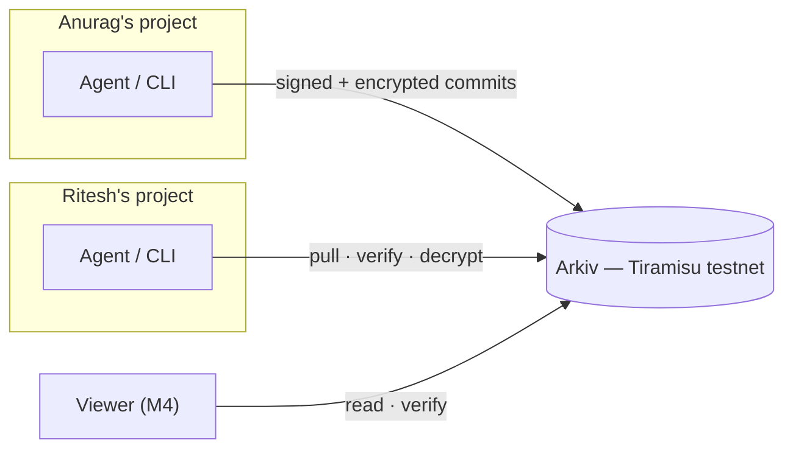
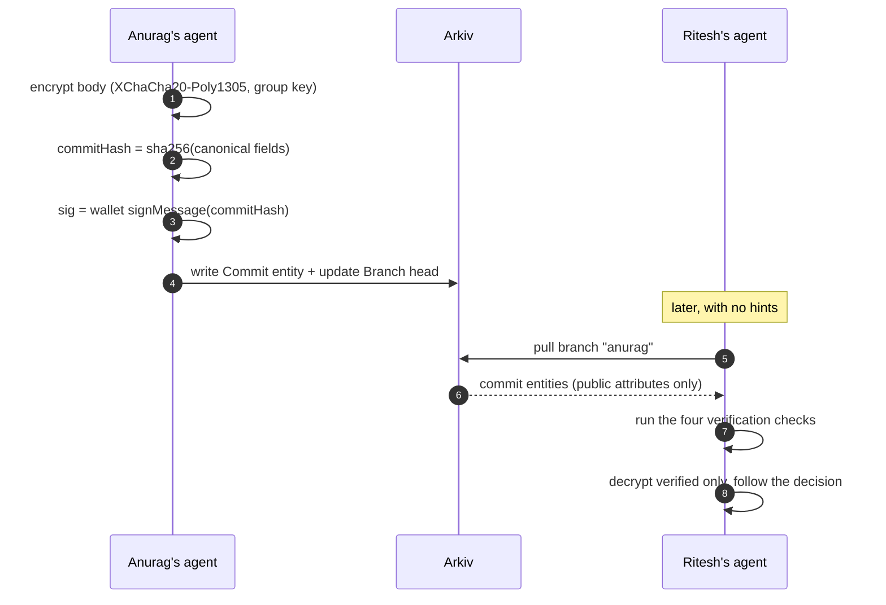
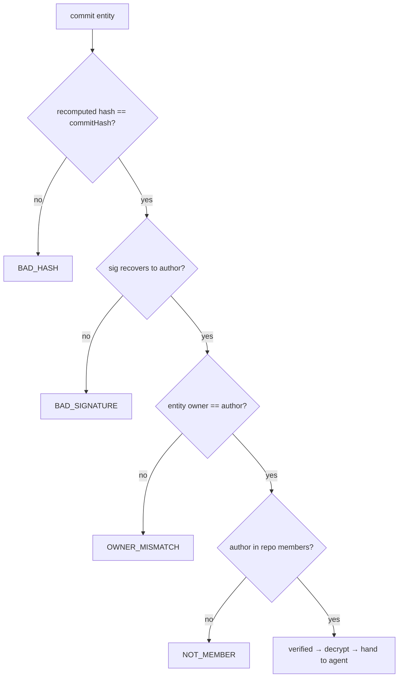

# Cogit

**Encrypted, wallet-signed team context on [Arkiv](https://arkiv.network) — shared memory your coding agents can actually trust.**


Every coding session ends, and so does everything the agent learned. Teammates re-explain the same decisions, agents re-derive the same schema, and "why did we do this?" reaches back into a chat log nobody reads.

Cogit gives a team one durable place for context that agents read and write on their own:

- **F1 — Commit context.** An agent (or human) records a short, encrypted, wallet-signed entry on its branch. It lives on Arkiv with an expiry that matches its importance.
- **F2 — Pull it live.** A teammate's agent pulls a branch before starting related work — every entry verified, decrypted, and followed, without asking anyone for anything.
- **F3 — See it.** A web page draws branches as a graph, lists commits, and shows decrypted context with its verification status.

## Why not just git?

| | git | Cogit |
|---|---|---|
| identity | `user.email` — self-declared, forgeable | **wallet address — proven by signature** |
| authorship proof | optional GPG, manual key distribution | **four ordered checks against chain state** |
| storage | a repo its owner must host | **Arkiv entities, queryable by attribute, self-expiring** |
| read access | whoever can clone | **whoever holds the repo's group key** |
| expiry / GC | forever | **per-kind TTL — scratch dies in days, milestones live a year** |
| agent interface | — | **MCP server: `context_commit` / `context_pull` / `context_log`** |

## How it works



A commit's life, from one teammate's agent to the other's:



### Verification pipeline

Order matters — the first failure wins, and **invalid entries are never decrypted and never handed to an agent**:



`OWNER_MISMATCH` is the check git cannot make: it compares the envelope's author against the wallet that actually paid for the transaction on Arkiv — so a copied commit re-posted by someone else is rejected even with a valid signature.

### Crypto in one paragraph

The repo body is encrypted with XChaCha20-Poly1305 under a 32-byte **group key** generated at `init`. The `commitHash` is `sha256` over canonical JSON (`{v, repoId, branch, parent, author, kind, ts, nonce, ciphertextHash}` — sorted keys, no whitespace), and `sig` is the author's wallet signature over that hash. The group key proves *you may read*; the wallet key proves *you wrote*. They are deliberately separate.

## Data model (all attributes are public)

| Entity | Attributes | Payload | Expiry |
|---|---|---|---|
| **Repo** | `type=repo`, `repo_id`, `owner` | `{name, members: [address]}` | 365d |
| **Branch** | `type=branch`, `repo_id`, `name`, `owner`, `head`, `forked_from` | — | 365d (refreshed on update) |
| **Commit** | `type=commit`, `repo_id`, `branch`, `kind`, `author`, `ts`, `commit_hash`, `parent` | `CommitEnvelope` JSON | by kind |

Expiry by kind: `scratch` 3d · `note` 14d · `decision` 90d · `milestone` 365d.

```json
{
  "v": 1, "repoId": "5b7281f9534ac69f", "branch": "anurag",
  "parent": "0x03e7…", "author": "0x225F…", "agent": "opencode",
  "kind": "decision", "ts": 1760700000,
  "nonce": "b64…", "ciphertext": "b64…",
  "commitHash": "0x0a4d…", "sig": "0x…"
}
```

## Quickstart

```bash
git clone <this-repo> && cd cogit
pnpm install
cp .env.example .env          # add a funded Tiramisu testnet PRIVATE_KEY
pnpm test                     # 35 unit tests
pnpm build                    # standalone bundles: cogit CLI + cogit-mcp
```

Then, in any project directory:

```bash
pnpm cogit init team-brain                        # repo + main branch + group key (in .cogit/config.json, mode 600)
pnpm cogit invite 0xTeammate…                     # adds them to members, prints a cogit1: invite
# … teammate: cogit join cogit1:<repoId>:<groupKey>
pnpm cogit branch anurag && pnpm cogit use anurag # each person owns their branch
pnpm cogit commit -m "Postgres + JSONB for reports" --kind decision --details-file notes.md --tag db
pnpm cogit pull anurag                            # verified markdown → .cogit/context/anurag.md + stdout
pnpm cogit log                                    # verified / INVALID:<reason> per commit
```

```
cogit init <name>          create a repo and write .cogit/config.json
cogit invite <address>     add a member and print the invite string
cogit join <invite>        join a repo from an invite
cogit branch <name>        fork a branch from the current head
cogit use <branch>         switch branches
cogit commit …             encrypted, wallet-signed entry (kinds: scratch/note/decision/milestone)
cogit pull <branch>        verified markdown, oldest first
cogit log [--branch]       commits with verification status
```

## For agents (MCP)

`packages/mcp` is a stdio MCP server exposing three tools whose descriptions tell agents *when* to use them:

| Tool | Input | When the agent calls it |
|---|---|---|
| `context_commit` | `summary`, `details?`, `kind?`, `tags?` | immediately after making or learning a decision |
| `context_pull` | `branch`, `kind?`, `tag?` | before work a teammate may have specified |
| `context_log` | `branch?`, `n?` | to survey activity or confirm a commit landed |

```json
{
  "mcp": {
    "cogit": {
      "type": "local",
      "command": ["node", "<repo>/packages/mcp/dist/index.js"]
    }
  }
}
```

Copy-paste configs for Claude Code, Cursor, and opencode — plus the `CLAUDE.md` / `AGENTS.md` snippet — live in [docs/MCP_SETUP.md](docs/MCP_SETUP.md).

### Verified with two real agents

Agent A (wallet 1) committed a decision via MCP. Agent B (wallet 2, separate project), asked only *"write the DB schema for the reports page"*, called `context_pull("anurag")`, produced a schema matching the decision, and recorded its own entry on its branch. Both commits verified cross-wallet via `cogit log`.

## Install as a package

The CLI builds to a single dependency-free file and can be installed like any tool:

```bash
pnpm build
cd packages/cli && pnpm pack --pack-destination /tmp   # cogit-cli-0.1.0.tgz (~200 KB)
npm install -g /tmp/cogit-cli-0.1.0.tgz
cogit --version
```

(The same flow is what an npm publish or a Snap Store release wraps.)

## Repository layout

```
packages/
  core/     protocol: crypto, envelope, verification, Arkiv wrapper, ops, branch graph
  cli/      `cogit` — the 8 commands above
  mcp/      `cogit-mcp` — context_commit / context_pull / context_log
  viewer/   static React site (M4, in progress)
docs/
  ARKIV_NOTES.md    spike-proven API names, units, limits
  FRICTION_LOG.md   8 logged surprises (each reproducible)
  MCP_SETUP.md      per-client agent setup
scripts/
  spike.ts          M0 on-chain self-test (7 checks)
  build.mjs         bundles cli + mcp
```

## Why Arkiv

| Feature used | Why it matters here |
|---|---|
| attribute queries (`type`, `repo_id`, `branch`) | pull a branch or list commits without any indexer of our own |
| per-kind expiry | context self-expires: scratch disappears in days, milestones last a year — no GC cron |
| entity ownership | the chain itself attests which wallet wrote an entity → the `OWNER_MISMATCH` check |
| `patchEntity` on branch head | git-style `head` pointer that the owner advances on each commit |
| repo `members` in payload | verifiers enforce `NOT_MEMBER` fully offline |

## Trust model

**Public:** repo/branch names, commit kinds, author addresses, timestamps, hashes, tags’ existence — never contents. **Private:** summaries, details, tags, code snippets (encrypted), and the group key. Inviting someone shares read access; there is no way to grant write access to a branch you own other than handing over the wallet — branch heads are single-writer by construction (see [F-8](docs/FRICTION_LOG.md)).

## Limits worth knowing

- Arkiv entity cap is **128 KiB including attributes**; `details` is truncated at 96 KiB with a marker.
- Attribute names must be **lowercase** (`repo_id`, `commit_hash`), values ≤ 128 bytes.
- Expiry granularity is one block (2s); writes return before mining — receipts are awaited where it matters.
- `.cogit/config.json` holds the group key (mode 600) and is gitignored; the viewer takes the key in memory only.

## Status

| Milestone | Scope | State | Proof |
|---|---|---|---|
| M0 | Arkiv spike | **done** | 7/7 checks PASS in `pnpm spike` |
| M1 | `core` | **done** | `pnpm test` — 35 tests (hash, sign, crypto, every failure reason) |
| M2 | `cli` | **done** | 2 wallets: commit on A, verified pull on B |
| M3 | `mcp` | **done** | 2 real agents: commit → pull → follow |
| M4 | `viewer` | in progress | branch graph, commit list, decrypted detail, 5s refresh |
| M5 | seed + docs | planned | `scripts/seed.ts`, fresh-clone demo in <10 min |

## Documentation

- [SPEC.md](SPEC.md) — scope, data model, milestones
- [docs/ARKIV_NOTES.md](docs/ARKIV_NOTES.md) — spike-proven API surface
- [docs/FRICTION_LOG.md](docs/FRICTION_LOG.md) — every surprise, reproducibly
- [docs/MCP_SETUP.md](docs/MCP_SETUP.md) — agent setup, verified scenario

## Development

```bash
pnpm test          # vitest, 35 tests
pnpm build         # esbuild bundles → packages/*/dist
pnpm spike         # live on-chain self-test against Tiramisu
pnpm cogit <cmd>   # run the CLI from source via tsx
```
